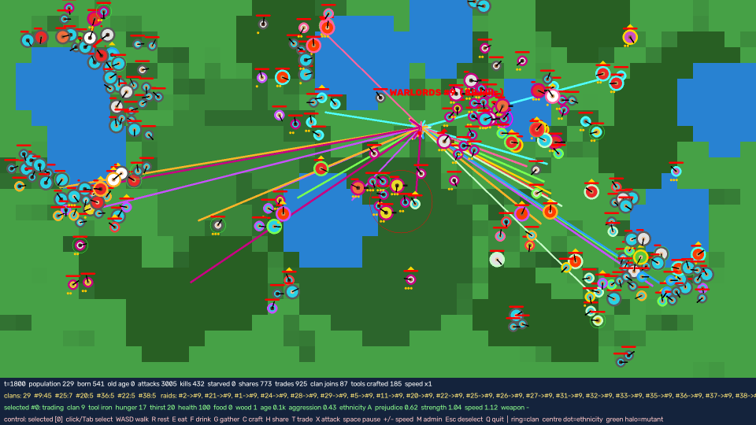
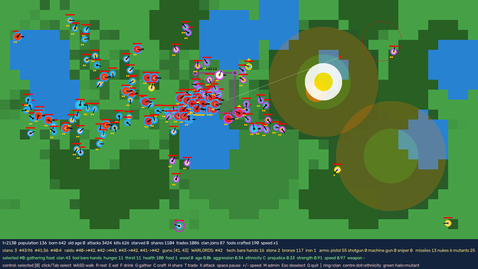

# Life: An Emergent Civilization Simulator

A real time, rule based simulation of a human society on a small island. Hundreds of autonomous people search for food and water, raise children, trade, form clans, build fortresses, advance their technology, wage war, and sometimes destroy each other with nuclear weapons. None of this is scripted as a story. Every empire, rebellion, and collapse you see emerges from a short list of individual rules.

The project is a single Python file built on NumPy and OpenCV. It runs fullscreen and comes with a live admin panel that lets you act as a god over the world.



*Every clan on the island has declared war on the current Warlords. Each colored arrow is one clan's raid.*



*A world war. Two nuclear blasts are expanding over the east while armies fight across the central lake.*

---

## Table of Contents

1. [Quick Start](#quick-start)
2. [How It Works](#how-it-works)
3. [Feature List](#feature-list)
4. [Controls](#controls)
5. [Admin Panel](#admin-panel)
6. [Reading the Screen](#reading-the-screen)
7. [Simulation Rules and Constants](#simulation-rules-and-constants)
8. [Emergent Behavior Observed](#emergent-behavior-observed)
9. [Project Structure](#project-structure)
10. [What I Learned](#what-i-learned)
11. [Known Limitations](#known-limitations)
12. [Roadmap](#roadmap)
13. [License](#license)

---

## Quick Start

**Requirements:** Python 3.10 or newer, on Windows, macOS, or Linux. Windows is the most tested.

```bash
git clone https://github.com/6876h9/life-sim.git
cd life-sim
pip install -r requirements.txt
python life.py
```

The window opens fullscreen and the island stretches to fit your screen. Press `Q` to quit.

### Command line options

| Option | Default | Description |
|---|---|---|
| `--humans` | 50 | Starting population |
| `--aggression` | 0.5 | Average aggression of the founders (0 = peaceful, 1 = violent) |
| `--discrimination` | 0.5 | How strongly prejudice affects behavior (0 = none, 1 = strong) |
| `--rows` | 24 | Island height in tiles. The width is chosen to fill the screen |
| `--speed` | 1 | Simulation steps per drawn frame (can also be changed live with `+` and `-`) |
| `--seed` | 0 | Random seed. The same seed always produces the same island and founders |
| `--war` | 0 | If set, automatically start a world war at this frame |

Examples:

```bash
python life.py --humans 120 --aggression 0.8          # a violent world
python life.py --humans 90 --war 300                  # world war after 300 frames
python life.py --seed 7 --discrimination 1.0          # a new island with strong prejudice
```

---

## How It Works

The simulation is an **agent based model**. There is no training and no machine learning. Each person runs the same priority list every frame and picks the first rule that applies:

1. **Defend the clan.** If a clanmate was attacked recently, move toward the attacker and fight.
2. **Raid.** If the clan is at war, march with the leader toward the enemy clan and attack.
3. **Fight.** If an enemy is in reach, attack with a probability based on aggression, trust, hunger, grudges, and prejudice.
4. **Drink.** If thirsty, walk to the nearest water and drink.
5. **Eat.** If hungry, eat carried food or food on the ground, or walk to the nearest food.
6. **Heal.** If hurt and nobody is nearby, rest.
7. **Craft.** If there are enough materials, upgrade tools or weapons.
8. **Build.** If the clan is large enough, carry wood to the clan fortress.
9. **Hunt.** Aggressive people walk toward nearby strangers they do not trust.
10. **Be social.** Share food or trade with whoever is close.
11. **Work.** Gather food or wood, otherwise wander near the clan.

Large scale history comes out of the interaction of these rules with each other, with population growth, and with the shape of the map.

---

## Feature List

### World
- Procedurally generated island with grass, lakes, and forests
- Food grows on grass and regrows over time; lakes provide water; forests provide wood
- The island fills the whole screen in fullscreen mode
- Fixed random seeds make every world reproducible

### People
- Continuous, free movement with smooth steering around lakes and personal space between people
- Needs: hunger, thirst, and health. Running out of food or water drains health
- Inventory of food and wood
- Individual traits: aggression, prejudice, strength, speed, ethnicity
- Ageing, adulthood at 400 frames, and death from old age around 9000 frames

### Family and Reproduction
- No population cap. Healthy, fed adults with spare food have children
- Children inherit their parent's ethnicity and traits with small random variation
- Rare large mutations (about 4 percent of births) produce stronger, faster, or more extreme people, marked with a green halo
- Children always join their parent's clan and start with strong trust toward their family
- Children are protected: nobody can attack a child, and children do not carry or use weapons
- Children are drawn smaller than adults

### Society and Economy
- Trust between every pair of people, built by sharing and trading and destroyed by violence
- Sharing gives food to someone in need
- Trading swaps one unit of a person's surplus for one unit of the other's
- Trust slowly fades over time, so both friendships and grudges decay
- Statistics for every share, trade, and clan join

### Clans
- Clans form automatically when two people trust each other enough
- Clanmates never attack each other and pass their tool knowledge to each other
- Each clan has a leader, chosen among adults by tool level, age, and health, and shown with a crown
- Clans move as groups and settle around their center
- **Raids:** aggressive clans with three or more members march on the nearest rival clan in formation behind their leader
- **Clan rally:** when one member is attacked, nearby clanmates rush to help
- **Rebellions:** in clans of twenty or more, small factions of two to four members can break away and declare war on their former clan

### The Warlords Title
- The living clan with the most total kills (at least five) holds the title **WARLORDS**
- Every other clan with two or more members automatically declares war on the Warlords
- The title is shown with a red label above the clan and a red crown on its leader

### Technology
- Four tool levels: bare hands, stone, bronze, and iron, crafted from wood and food
- Better tools gather more food and wood and deal more melee damage
- Knowledge spreads through clans and occasionally through trade
- Technology can be lost when the people who hold it die, which happens after large wars

### Weapons
- Clans with ten or more members are armed with guns
- Gun holders can upgrade their pistol based on personality:

| Weapon | Range (tiles) | Damage | Cooldown (frames) | Notes |
|---|---|---|---|---|
| Pistol | 4.0 | 35 | 18 | Default gun |
| Shotgun | 2.5 | 30 | 22 | Hits up to three nearby enemies |
| Machine gun | 4.5 | 14 | 5 | Chosen by aggressive people |
| Sniper | 9.0 | 75 | 45 | Chosen by calm people |

- Gunfire is drawn as yellow tracer lines; each weapon has a distinct barrel shape

### Weapons of Mass Destruction
- Clans with fifteen or more members at war launch **missiles** (2 tile blast)
- Clans with twenty five or more members at war launch **nuclear weapons** (6 tile blast)
- Missiles and nukes fly visibly across the map before exploding
- Nukes spare the launching clan, kill almost everyone else in range, scorch the food in the blast zone, and knock fortresses down three levels
- Bombed clans declare war on the clan that bombed them

### Fortresses
- Clans with eight or more members collect wood and build a fortress at their center
- Three levels, costing 10, 25, and 50 wood
- Defenders inside take 30, 50, or 70 percent less damage and slowly heal
- Fortresses are damaged by missiles and nukes and disappear when their clan dies out

### Discrimination
- Every person belongs to one of four ethnic groups, shown by the dot in the center of their circle
- Every person has a personal prejudice level that is inherited by their children
- Toward other groups, prejudiced people build trust more slowly, share less, are less willing to join the same clan, and are up to three times more likely to attack
- The global strength of discrimination can be changed at launch or live from the admin panel

### Interface
- Fullscreen rendering with a live information panel
- Click to select a person and see their needs, inventory, age, traits, tool, weapon, and current activity
- Keyboard control of the selected person, or of everyone at once
- Shift click and Shift drag group selection
- Pause, single step, and speed control up to 64 times
- A full admin panel for intervening in the world (see below)

---

## Controls

| Key | Action |
|---|---|
| Left click | Select a person (pink ring) |
| Right click | Set a target (orange ring) |
| Shift + click | Add or remove a person from the group (cyan ring) |
| Shift + drag | Box select a group |
| `Tab` | Select the next person |
| `0` | Switch between controlling the selected person and controlling everyone |
| `W` `A` `S` `D` | Walk |
| `R` | Rest |
| `E` | Eat |
| `F` | Drink |
| `G` | Gather |
| `C` | Craft |
| `H` | Share food |
| `T` | Trade |
| `X` | Attack |
| `Space` | Pause or resume |
| `N` | Advance one step while paused |
| `+` / `-` | Speed up or slow down |
| `M` | Open or close the admin panel |
| `Esc` | Clear the group, the target, and control of everyone |
| `Q` | Quit |

---

## Admin Panel

Press `M` to open the panel. While it is open, keys act as admin commands instead of controlling people. Commands marked *group* act on the Shift selected group if there is one, otherwise on the selected person.

| Key | Command |
|---|---|
| `1` | Create a new clan from the group, or from the selected person and everyone within three tiles |
| `2` | The group joins the target's clan |
| `3` | Kick the group out of their clans |
| `4` | The selected person's clan raids the target's clan |
| `5` | Every clan attacks the target's clan |
| `6` | Peace: cancel all raids and grudges |
| `7` | Spawn ten people near the selected person |
| `Y` | Spawn ten people at the mouse cursor |
| `O` | Fifty immigrants arrive across the island |
| `8` | Kill the group *(group)* |
| `Z` | Wipe out the target's entire clan |
| `9` | Heal and feed the group *(group)* |
| `I` | Toggle invincibility *(group)* |
| `L` | Teleport the group to the mouse cursor *(group)* |
| `G` | Give or take guns *(group)* |
| `V` | Cycle gun type: pistol, shotgun, machine gun, sniper *(group)* |
| `U` | Upgrade tools *(group)* |
| `X` | Mutate: stronger and faster *(group)* |
| `J` | Grow children up to adults *(group)* |
| `[` / `]` | Lower or raise the selected person's aggression |
| `K` | Give the selected person's clan the Warlords title |
| `W` | **World War:** split everyone into four armed armies and start raids |
| `B` | Fire a missile from the selected person's clan at the target |
| `N` | Fire a nuclear weapon at the target |
| `R` | Start a rebellion inside the selected person's clan |
| `H` | Give the selected person's clan an instant level three fortress |
| `F` | Feast: fill all grass with food |
| `D` | Drought: remove all food |
| `E` | Dissolve every clan |
| `P` | Cycle discrimination between 0, 0.5, and 1 |
| `C` | Clear the group selection |

Deaths caused by the admin panel are not counted in the kill statistics.

---

## Reading the Screen

| Element | Meaning |
|---|---|
| Circle fill color | Current activity: red fighting or raiding, orange hunting, yellow sharing, cyan trading, light blue drinking, green eating, purple crafting, white just hit |
| Outer ring color | Clan. Gray means no clan |
| Center dot | Ethnic group |
| Small circle | A child |
| Red bar above | Health |
| Gold dots below | Tool level: one stone, two bronze, three iron |
| Black barrel | Gun. Short is pistol, thick is shotgun, medium gray is machine gun, long and thin is sniper |
| Gold crown | Clan leader. A red crown marks the leader of the Warlords |
| Green halo | Mutant |
| White halo | Invincible |
| Colored arrow | A raid from one clan to another |
| Red line | A melee hit |
| Yellow line | Gunfire |
| Dot with a trail | Missile or nuke in flight. The red circle marks the blast zone |
| Gray walled square | Fortress, labeled with its clan and level |

The bottom panel shows world totals (population, births, deaths, kills, shares, trades, missiles, nukes, mutants, forts, rebellions, children), the clan list, active raids, technology and weapon counts, and full details for the selected person.

---

## Simulation Rules and Constants

All values are defined at the top of `life.py` and can be tuned.

| Rule | Value |
|---|---|
| Walking speed | 0.09 tiles per frame, multiplied by the person's speed trait |
| Melee reach | 1 tile |
| Action cooldown | 18 frames |
| Hunger gain | 0.06 per frame |
| Thirst gain | 0.09 per frame |
| Starvation damage | 0.4 health per frame at 100 hunger or thirst |
| Adult age | 400 frames |
| Lifespan | about 9000 frames, plus or minus 1500 |
| Birth chance | 1.2 percent per frame for a fed, watered, healthy adult with spare food |
| Trust needed to join a clan | 1.5 |
| Tool costs (wood, food) | stone 3, 0. bronze 5, 2. iron 8, 4 |
| Melee damage | 15 plus 8 per tool level, multiplied by strength |
| Gun clan size | 10 |
| Missile clan size | 15 |
| Nuke clan size | 25 |
| Missile cooldown | 240 frames |
| Nuke cooldown | 1500 frames |
| Fortress clan size | 8 |
| Fortress costs | 10, 25, 50 wood |
| Fortress armor | 30, 50, 70 percent |
| Rebellion clan size | 20 |
| Warlords threshold | 5 kills |

---

## Emergent Behavior Observed

These patterns appeared during testing without being programmed directly:

- **Lake civilizations.** Thirst is the fastest growing need, so people return to water constantly. Children are born next to their parents, so every city forms as a ring around a lake.
- **The empire cycle.** One clan gets an early lead, grows fastest through births, reaches the size for guns, then missiles, then nukes, and absorbs or destroys every rival. Once it controls the island, it stays peaceful until something breaks it apart.
- **The Warlords curse.** Because every clan attacks the title holder, a weak clan that earns the title is usually destroyed within moments, and the clan that lands the final blows often inherits the title and the same fate.
- **Mutually assured destruction.** In world wars, the largest armies nuke each other at the same time and lose most of their people, while small clans far from the fighting survive and become the next empire.
- **Lost technology.** Wars that kill the people who know iron send the survivors back to the stone age, and the knowledge has to be rediscovered.
- **Self inflicted damage.** A clan nuking an enemy standing near its own fortress destroys the fortress, because blasts damage buildings regardless of owner.
- **Wartime economies.** Trading continues during wars, because only the front line is fighting and the rest of the population keeps doing business.
- **Founder effects.** After a near extinction, the whole new population descends from a few survivors and inherits their unusual traits.

---

## Project Structure

```
life-sim/
├── life.py            # The entire simulation: world, rules, AI, rendering, admin panel
├── requirements.txt   # Python dependencies
├── docs/              # Screenshots used in this README
├── LICENSE
└── README.md
```

Inside `life.py`:

| Section | Responsibility |
|---|---|
| Constants | All tunable rules and colors |
| `World` | Terrain, people, needs, actions, clans, fortresses, missiles, births, deaths, and the time step |
| `RuleAI` | The priority based decision rules for each person |
| `render` | Drawing the map, people, effects, and information panel |
| `admin_command` | The admin panel commands |
| `main` | Fullscreen window, input handling, and the main loop |

---

## What I Learned

This project started as an attempt to train a Geometry Dash bot with neuroevolution and ended as a civilization simulator. Along the way it taught me a lot.

**Simple rules create complex history.** Each person follows about a dozen priorities, yet the world produces empires, coalitions, arms races, rebellions, dark ages, and nuclear standoffs. The interesting behavior lives in the interaction between rules, not in any single rule.

**Small rule changes have large consequences.** Making 30 percent of children start outside their parent's clan turned every empire into a machine that hunted its own newborns. Letting the healthiest member lead put toddlers in charge of armies. Counting children as clan members let a single protected child keep a dead clan alive and hold the Warlords title. Each of these was a one line rule with an island wide effect.

**Feedback loops dominate.** Bigger clans have more children, which makes them bigger, which unlocks guns, which wins wars, which makes them bigger still. Most of the drama in the simulation comes from positive feedback loops like this and from the few mechanisms that break them, such as rebellions and world wars.

**Learned AI versus rule based AI.** The first version used NEAT (NeuroEvolution of Augmenting Topologies) to evolve each person's brain. Evolution exploited loopholes in the reward instead of learning the intended behavior: when walking was rewarded, the population learned to walk forever and die of thirst. Switching to hand written rules gave immediate, readable, controllable behavior, which was a better fit for a sandbox meant to be watched and played with.

**Vectorization and performance.** Rewriting the original NEAT trainer to process every agent at once with NumPy, and replacing full map scans with a precomputed lookup table, made training several times faster. In the current simulator, the cost of comparing every person with every other person is what limits the population, which shows why spatial partitioning matters for agent based models.

**Debugging emergent systems.** The hardest bugs did not crash the program. They produced strange but plausible behavior: tools going backwards, raids against clans that no longer existed, armed children, and leaders who could not fight. The way to find them was to watch the simulation, describe what looked wrong, and trace it back to the rule responsible.

**Removing limits exposes new limits.** Removing the population cap revealed that food was not actually limiting growth and that performance was. Each constraint that was removed showed where the next one was hiding.

---

## Known Limitations

- **Performance at large populations.** Every person checks every other person each frame, so the simulation slows down noticeably above roughly 500 to 800 people.
- **Food rarely limits growth.** Without a war, famine, or admin intervention, the population can grow until it fills the map.
- **Founders begin as children.** Starting humans are created at age zero, so the first 400 frames of a new world are calm.
- **Protected children can keep a clan alive.** A clan whose adults are all dead still exists, and can still hold the Warlords title, while its children live.
- **Deterministic worlds.** The default seed always produces the same founders. Use `--seed` for variety.

---

## Roadmap

- Spatial grid for neighbor searches, to support thousands of people smoothly
- Births limited by available food, so populations level off naturally
- Founders that start as adults
- Only adults count toward a clan's survival and the Warlords title; orphans are adopted by nearby clans
- Diplomacy: alliances, peace treaties, and trade agreements between clans
- Saving and loading worlds
- Graphs of population, technology, and kills over time

---

## License

Released under the MIT License. See [LICENSE](LICENSE) for details.
